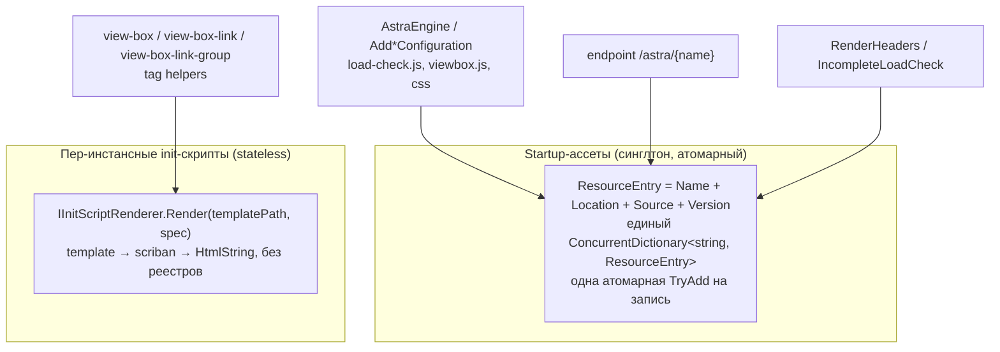

# План: устранение архитектурной проблемы реестра ресурсов Astra

Основан на отчёте `docs/viewbox-link-init-registration-race.md`.
Патч-костыль (порядок записей storage→реестр) уже в дереве — он не откатывается, а переживает
рефакторинг как feature-уровень регрессии (`ResourceRegistrationRaceTests`).

Работа разбита на **этапы**. Этап закрыт, когда выполнены его пункты и провален-починен
соответствующие тесты: каждый шаг начинается с теста, который краснеет до изменения кода.

## Диагноз одной фразой

Факт «ресурс `name` существует, рендерится в `location`, содержит `content`, версия `hash`»
размазан по четырём `ConcurrentDictionary` в двух синглтонах + один реестр движка; join —
строковый ключ, согласованность обеспечивается порядком вызовов, а не структурой.

Следствия: torn write (исходный баг, лечится только дисциплиной), first-write-wins молча
(ViewBox collision — доказано прогоном), неограниченный рост при data-derived Id,
публичный URL-namespace `/astra/*` засоряется пер-инстансными именами, `resourceHtml` — мёртвый
код, hash-версия считается для Body, где никогда не читается.

## Целевая архитектура

Два чистых времени жизни вместо одного синглтона на всё:



Инварианты после рефакторинга:

1. Один ключ → одна атомарная запись; «полурегистрированного» ресурса нельзя выразить типом.
2. Tag helper не мутирует ни один синглтон: нет роста, нет гонок, нет first-write-wins.
3. Имена `viewbox-*` живут в одном месте (константы в спецификациях): движок и tag helper
   физически не могут зарегистрировать одно имя с разной локацией.
4. Body-ресурсы не получают `?v=` и не светятся в URL-пространстве.

Совместимость: библиотека на NuGet — публичный API ломаем минимально, новые методы добавляем
default interface methods (net7+), устаревшие пути помечаем, а не удаляем в один минор.

---

## Этап 1 — расчистка: мёртвый код, доказанные баги, ложные стоимости

Архитектуру не меняет.

- [x] **Удалить `resourceHtml`** (`HtmlResourceRenderer.cs:18`) — 0 записей, 0 чтений.
- [x] **Fix коллизии ViewBox (доказанный баг).** Решение по отчёту 2026-10-30: вместо «хранить
  спецификации + явный `AddViewBoxScriptResource`» целиком **удалён недокументированный manual-path**
  `AstraEngine.AddViewBox` / `AddViewBoxLink` / `GetViewBoxLinkClass` вместе со словарём
  `linkSpecifications` (0 callsites в demo/template/docs, только пиновщие тесты; в комбинации с
  tag helper'ами ломал Body-рендер ViewBox крашем и давал двойной init для Link). Движок регистрирует
  только startup-ассеты; init остаётся за tag helper'ами. **Breaking change → релиз 2.0.0.**
- [x] **`CalculateResourceHash` только для Header.** Body-ресурсы версию не читают
  (`RenderBodyResource` инлаейнит) — убрать SHA256-проход: пропуск по локации.
- [x] **Убрать timestamp-fallback хеша.** Сейчас при исключении `?v=<unix-time>` — разные значения
  на разных нодах → cache thrashing. Fallback: пустая версия (ресурс без `?v=`), ошибка — в лог
  (`ILogger<HtmlResourceRenderer>`, optional ctor-param — DI внедряет, тесты конструируют без него).
- [x] **Удалить вложенный заглушечный проект** `src/AlienFruit.Astra.Tests/TestTagHelper/`
  (`Program.cs` = `Hello, World!`, в решении не подключён). Снимает необходимость костыля
  `<Compile Remove="TestTagHelper\**" />` в `AlienFruit.Astra.Tests.csproj`.
- [x] Тесты (красный до → зелёный после):
  - [x] `AstraEngineTests.RenderHeaders_Then_ViewBoxTagHelper_DoesNotThrow` — mixed-использование
    движка и tag helper'ов на реальном renderer/storage (коллизия больше невыразима типом).
  - [x] `AstraEngineTests.EngineRenderHeaders_DoesNotPreRegisterTagHelperInitNames` — движок не
    занимает имена tag helper'ов (`viewbox-init-*`, `viewbox-link-init-*`).
  - [x] `HtmlResourceRendererTests.AddJsCode_BodyLocation_DoesNotComputeVersion` — `GetResourceUrl`
    без `?v=` при включённом versioning, тогда как Header-ресурс его получает.
  - [x] `HtmlResourceRendererTests.CalculateResourceHash_StorageThrows_VersionStaysEmpty` — моки
    storage, бросающие на `OpenRead`: URL без `?v=<timestamp>`.
  - удалены пиновшие manual-path тесты: `AddViewBox_WithViewBoxSpecification_*`,
    `AddViewBoxLink_WithViewBoxLinkSpecification_*`, `AddViewBoxLink_WithDuplicateSpecification_*`,
    `GetViewBoxLinkClass_*` (×3).
- [x] Прогон: `dotnet test -f net10.0` — 127 зелёных (129 базовых − 6 удалённых + 4 новых),
    `dotnet build -c Release` net7–net10 — succeeded; solution (lib + demo MVC + RazorPages + tests) —
    succeeded.

## Этап 2 — атомарный реестр синглтона (ломает torn write по структуре)

- [x] **Новая модель** `ResourceEntry` (internal record): `Name`, `Kind`, `Location`,
  `Source` (закрытый тип: `EmbeddedSource(path, assembly)` | `CodeSource(content)`),
  `Version` (`Lazy<string>?`) — вычисляется один раз, лениво, только при Header-чтении
  (`ResourceEntry.cs`); пустой хеш (сбой) не даёт `?v=`.
- [x] **Схлопнуть словари** `HtmlResourceRenderer`: `resourceScripts` + `resourceStyles` +
  внешний join с `IResourceStorage` → один `ConcurrentDictionary<string, ResourceEntry>`.
  Все четыре `Add*` конструируют entry целиком и делают единственную `TryAdd`. Дисциплина
  «storage раньше реестра» стала ненужной: состояния «имя есть, контента нет» не существует
  (тест `Registry_IsASingleAtomicStore_NoSplitLocationDictionaries`).
- [x] `RenderBodyResource`/`RenderHeaders`/`IsResourceExists`/`GetResourceVersion` читают из entry
  (Body-контент — из `entry.Source`; хеш embedded — через storage.OpenRead, как раньше,
  чтобы URL-и `?v=` не поменялись).
- [x] Публичный контракт `IResourceStorage` сохранён: renderer проксирует в storage только
  **Header**-записи (endpoint `UseAstra` их отдаёт; Body-ресурсы в URL-пространство не
  попадают — инвариант 4 уже на этом этапе).
- [x] **Перестать молча подменять контент:** повторный add того же имени с другим содержимым
  (или другой kind/location) → `InvalidOperationException` вместо тихого first-write-wins;
  идентичная повторная регистрация — идемпотентный no-op.
- [x] Тесты:
  - [x] `HtmlResourceRendererTests` — перенесены без изменения публичного поведения.
  - [x] `ResourceRegistrationRaceTests` — **зелёные без единой правки** (файл не в `git diff`).
  - [x] `AddJsCode_SameNameDifferentContent_Throws` (+ `AddScriptResource_SameNameDifferentPath_Throws`,
    `AddJsCodeFromTemplate_SameNameDifferentSpecification_Throws`).
  - [x] `GetResourceUrl_ConcurrentSameHeaderResource_ComputesHashOnce` — 16 потоков, один хеш,
    регистрация не читает контент (`OpenReadCount == 0` до первого чтения).
- [x] Прогон: полный набор 132/132 (net10.0) + `Release` net7–net10 + solution (demo, tests) —
  succeeded; smoke-прогон demo: home=200, `/astra/viewbox.js`=200, `?v=` идентичен этапу 1,
  инлайн-init 1×`ViewBoxRegistry.create` + 12×`registerUri`, `load-check` в `<script>` в Body.

## Этап 3 — stateless пер-инстансные скрипты (главный сдвиг)

- [x] **Новый сервис** `IInitScriptRenderer` (public интерфейс, internal реализация):

  ```csharp
  public interface IInitScriptRenderer
  {
      IHtmlContent RenderInline<T>(string resourceName, string templatePath, T specification) where T : class;
  }
  ```

  Чистая функция: embedded template → Scriban → `<script>…</script>`. Ни словарей, ни storage.
  `resourceName` — не в реестр, а только для компрессора (Nuglify выбирает минификацию по
  расширению имени, как в старом пути через storage) — вывод байт-в-байт прежний.
  Регистрация: `AddSingleton` (stateless, дёшево).
- [x] **Перевести tag helper'ы** (`ViewBox`, `ViewBoxLink`, `ViewBoxLinkGroup`) с пары
  `AddJsCodeFromTemplate(..., Body)` + `RenderBodyResource(...)` на один `RenderInline`.
  Конструктор: `IHtmlResourceRenderer` заменён на `IInitScriptRenderer` (старый параметр стал
  мёртвым); helper'ы создаются DI; ручное `new` только в тестах
  (`ViewBoxLinkTests.CreateViewBoxLink` через `Activator` — поправлен).
  Порядок внутри этапа: `ViewBoxLink` → `ViewBox` → `ViewBoxLinkGroup`.
- [x] `AddJsCodeFromTemplate(..., Body, ...)` и `RenderBodyResource` **остаются** для
  startup-Body (`load-check.js`) и документированного пользовательского сценария; tag helper'ы
  их больше не используют. `[Obsolete]` не вешать — XML-doc ограничивает область применения
  (`IHtmlResourceRenderer.AddJsCode/AddJsCodeFromTemplate/RenderBodyResource`).
- [x] **Побочные эффекты (зафиксированы как исправления, не фичи):**
  - [x] `/astra/viewbox-link-init-{Id}` перестаёт отдаваться — smoke-прогон demo: 404
    (было 200 до этапа); закрывается утечка имён в URL-namespace.
  - [x] Два запроса с разным контентом под одним Id больше не могут обменяться скриптами —
    staleness устранён по построению (нет общего состояния).
  - [x] Нулевой рост памяти по именам ссылок/вьюбоксов — тест
    `SingletonRegistry_DoesNotGrow_OverManyGeneratedIds` (3000 скриптов, `entries.Count` не изменился).
  - [x] Двойное подчёркивание `viewbox-link-group-init--{Id}` перестаёт иметь значение (имя уходит
    из глобального пространства) — сохранено как было, для совместимости golden-вывода.
- [x] Тесты:
  - [x] `ResourceRegistrationRaceTests.ViewBoxLinkProcess_ConcurrentSameId_ShouldNeverThrow` —
    зелёный. Отклонение от критерия «файл не меняется между этапами 1–3»: смена конструктора
    `ViewBoxLink` (п. выше) требует одну строку конструкции (`new InitScriptRenderer()` вместо
    renderer); сценарий, конкурентный каркас и ассерты не тронуты.
  - [x] `InitScript_IsNotRegisteredGlobally` — во всех трёх helper-файлах
    (`ViewBoxLinkTests`, `ViewBoxTests`, `ViewBoxLinkGroupTests`): после `Process`
    `IsResourceExists("viewbox-link-init-{id}") == false` + `RegisterResource` ни разу.
  - [x] Golden-тесты `InitScript_GoldenOutput_*` для трёх helper'ов: вывод `Process` содержит
    инлайн `<script>` с отрендеренным шаблоном (uri/viewBoxId/классы подставлены).
    `ViewBoxLinkGroupTests.cs` — новый файл (у group-хелпера покрытия не было вовсе).
  - [x] `SingletonRegistry_DoesNotGrow_OverManyGeneratedIds` (`HtmlResourceRendererTests`):
    1000 уникальных data-derived Id через три helper'а → `Count` реестра синглтона не изменился.
  - [x] `AstraEngineTests.RenderHeaders_Then_ViewBoxTagHelper_DoesNotThrow` — конструкции
    helper'ов обновлены под новый конструктор, ассерты не менялись.
- [x] Прогон: полный набор 144/144 (net10.0) + `Release` net7–net10 (lib + solution) —
  succeeded; smoke-прогон demo: home=200, `/astra/viewbox.js`=200 (тот же `?v=`),
  HTML главной страницы **побайтово идентичен** этапу 2, `/astra/viewbox-link-init-*`=404.

## Этап 4 — документация и закрытие хвостов

- [ ] `docs/basic-setup.md`, `docs/viewbox-tag.md`, `docs/viewbox-link-tag.md`: проверить, что
  нигде не остался ручный комбо-путь `AddViewBoxLink` + tag helper (сейчас docs показывают только
  `RenderHeaders` + `IncompleteLoadCheck`); добавить раздел «ресурсы: startup vs per-instance».
- [ ] `README-Versioning.md`: версия = только Header-ресурсы; поведение при сбое подсчёта хеша.
- [ ] Release notes версии: `AstraEngine.AddViewBox` / `AddViewBoxLink` / `GetViewBoxLinkClass`
  **удалены** (недокументированный manual-path, не использовался нигде в репозитории) — **мажор 2.0.0**
  с явным предупреждением: миграция = tag helper'ы (`<view-box>` / `<view-box-link>` вычисляют
  активный класс сами); падать смешанное использование перестало (был баг).
- [ ] Прогон: `dotnet build -c Release` net7–net10; сборка demo и template (`AlienFruit.Astra.Demo`,
  `AlienFruit.Astra.Demo.RazorPages`, `Template/AstraTemplate.csproj`) компилируется без правок.

---

## Критерии приёмки всего плана

- [ ] Исходный баг невозможен структурно: нет типа, позволяющего опубликовать имя раньше контента
  (этап 2), и нет имени в синглтоне для пер-инстансных скриптов (этап 3).
- [ ] `ResourceRegistrationRaceTests` не изменены между этапами 1–3 (feature-level константа).
- [ ] Смешанное использование engine + tag helper (доказанный кейс ViewBox) работает.
- [ ] Реестры синглтона не растут на уникальных data-derived `Id`.
- [ ] Ни один callsite из demo/template не сломан; `TestTagHelper`-костыль из csproj удалён
  вместе с проектом-заглушкой.

## Риски и гашение

| Риск | Механизм | Гашение |
|---|---|---|
| Пользователи полагаются на `AstraEngine.AddViewBox*` как источник Header-скриптов для кастомных `<a>` без tag helper | скрипты перестанут регистрироваться | решено 2026-10-30: manual-path удалён целиком (0 callsites, недокументирован, в комбинации был сломан); кастомным `<a>` — свои `<script>`/`ViewBoxRegistry` из JS-API; предупреждение в release notes 2.0.0 |
| чей-то JS ходит в `/astra/viewbox-*` напрямую | эндпоинт перестанет отдавать | проверить demo/docs — не используется; release notes |
| default interface methods на net7 | CLR поддерживает; для библиотеки нормально | CI matrix уже 7–10 |
| Объём этапа 3 (3 helper'а + DI) | один шаг на helper, каждый с тестом | история остаётся бисект-пригодной |

## Порядок выполнения

Этапы 1 → 2 → 3 → 4, каждый завершается зелёным прогоном тестов и `Release`-сборкой net7–net10.
Этапы 2 и 3 частично перекрываемы (entry-модель ценна и без statelessness), но перевод
tag helper'ов держать отдельно: он меняет набор отдаваемых HTTP-эндпоинтов и требует
осознанного release note.
